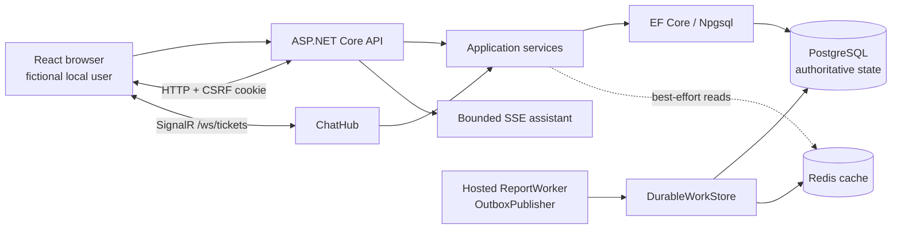

# Architecture and trade-offs

CollabDesk is a modular monolith. API owns HTTP, cookie authentication, CSRF, OpenAPI, SSE, and SignalR transport; Application coordinates use cases; Domain contains entities and state transitions; Infrastructure owns EF Core, PostgreSQL, Redis integration, migrations, and durable worker storage.

## EF Core and PostgreSQL

EF Core uses checked-in migrations and Npgsql. Development startup applies migrations and seeds local `*.test` users only; other environments must apply reviewed migrations explicitly. Correctness is database-backed: unique indexes cover idempotency and message de-duplication, transactions commit a ticket/idempotency response/outbox event together, and `ExecuteUpdateAsync` expresses conditional ticket transitions without a read-modify-write race. The `Ticket.Version` property is store-generated and configured as an EF concurrency token.

Limitations: in-memory/SQLite tests cannot prove PostgreSQL locking or provider SQL semantics. The repository includes guarded PostgreSQL acceptance tests; they require explicitly supplied, isolated test services. Schema migrations are not a substitute for a production migration rollout, backup plan, or rollback procedure.

## SignalR and chat

The hub authorizes ticket participants, persists messages with `(TicketId, ClientMessageId)` de-duplication, and uses PostgreSQL history/read cursors for reconnects. SignalR is therefore notification transport, not the history system of record.

SignalR uses the existing Redis deployment as its backplane, so hub groups work across API replicas. The configuration can disable that integration only for isolated tests. Presence/typing remain transient by design; multi-instance deployment still needs end-to-end operational testing.

## Async reports and transactional outbox

Report requests are durable rows. `ReportWorker` claims one item using `FOR UPDATE SKIP LOCKED`, assigns a lease, retries with bounded exponential backoff, and recovers expired leases. Completing a report writes the result and `report.completed` outbox event in one transaction. `OutboxPublisher` leases events similarly, publishes cache invalidation side effects, and makes retry attempts bounded and inspectable.

This provides at-least-once delivery, not exactly-once delivery: a process can fail after a side effect and before its acknowledgement. Consumers must remain idempotent (the cache invalidator does). Terminal failed jobs/events require operational attention; no alerting, dead-letter UI, distributed tracing, or external broker is included.

## Cache and concurrency

Redis caches identity-scoped ticket lists, agent stats, and message/history reads. Cache misses are coalesced in-process with short-lived locks. Cache version tokens are opaque and every invalidation creates a fresh token, so out-of-order at-least-once delivery cannot restore an old cache namespace. A Redis failure returns a database result instead of changing correctness behavior.

Limitations: cache coalescing is process-local; simultaneous cold reads on multiple API replicas may still reach PostgreSQL. Invalidations are eventually delivered, so a caller can briefly observe a stale cache entry. Redis must not hold the only copy of ticket, chat, or report state.
